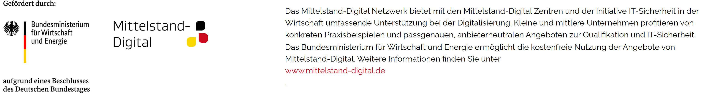

# Universelles Feedback-Formular zur Barrierefreiheit im Web

## Einführung

**In einem Satz:** Dies ist ein Open-Source-Feedback-Tool, mit dem Sie Feedback zur Barrierefreiheit erhalten können.

**Technische Details:** Implementiert mit HTML, SCSS und JavaScript. Bootstrap wurde für die Gestaltung der Komponenten verwendet, und Webpack wurde zum Bündeln und Bereitstellen der Dateien eingesetzt. Diese README-Datei enthält Anweisungen für die lokale Ausführung und die Erstellung des Projekts für die Produktion. Ein bereits erstelltes Beispielprojekt wird bereitgestellt. Derzeit wird das Feedback-Tool in englischer Sprache erstellt. Für eine deutsche Textversion sehen Sie sich bitte die Code-Anmerkungen an.
## Erste Schritte

### Voraussetzungen

Stellen Sie sicher, dass Node.js und npm auf Ihrem Rechner installiert sind.

### Installation

Klonen Sie das Repository und navigieren Sie im Terminal zum Projektverzeichnis.
`git clone <Repository-URL>
cd <Projektverzeichnis>` 

Installieren Sie die Abhängigkeiten mit npm.

`npm install` 

## Beispiel-Build
Im Repository-Ordner `dist` finden Sie einen Beispiel-Build für das universelle Feedback-Tool. (derzeit deutsche Version)

## Lokale Ausführung

Um das Projekt lokal auszuführen, verwenden Sie einen der folgenden Befehle:

`npm start` 
oder
`webpack serve` 

Rufen Sie `http://localhost:8080` in Ihrem Browser auf, um den Prototyp des Feedback-Tools anzuzeigen.

## Produktions-Build

Um das Projekt für die Produktion zu erstellen, verwenden Sie den folgenden Befehl:

`webpack build --mode=production` 

Die produktionsfertigen Dateien werden im Verzeichnis `dist` generiert.

## Integration

Das Projekt enthält eine Datei mit dem Link zum Feedback-Tool. Dieser Link wurde zu Demonstrationszwecken auf der Website von inovex implementiert. Wenn Sie ihn in eine andere Website integrieren möchten, passen Sie den JavaScript-Code entsprechend an. Beachten Sie, dass das JavaScript an die jeweilige Seite angehängt wird, sodass für andere Websites möglicherweise Anpassungen erforderlich sind.
ACHTUNG: Bitte ändern Sie die Datensicherheitsinformationen, Kontakt-E-Mails und Impressums-Links für Ihr Projekt.

## Veröffentlichungen
**Nominiert für den Best Paper Award** der Web 4 All Conference.

**Bitte zitieren Sie wie folgt:**
Adrian Wegener, Kathrin Fausel, Saskia Haug und Alexander Maedche. 2024. A Universal Web Accessibility Feedback Form: A Participatory Design Study.
In: Proceedings of May 13–14, 2024 (W4A’24). ACM, New York, NY, USA, 12 Seiten.
[https://doi.org/10.1145/3677846.3677853](https://doi.org/10.1145/3677846.3677853) 

Weitere Informationen zur Finanzierung des Projekts finden Sie unter folgendem Link: [https://www.digitalzentrum-fokus-mensch.de/](https://www.digitalzentrum-fokus-mensch.de/)

Übersetzt mit DeepL.com (kostenlose Version)
